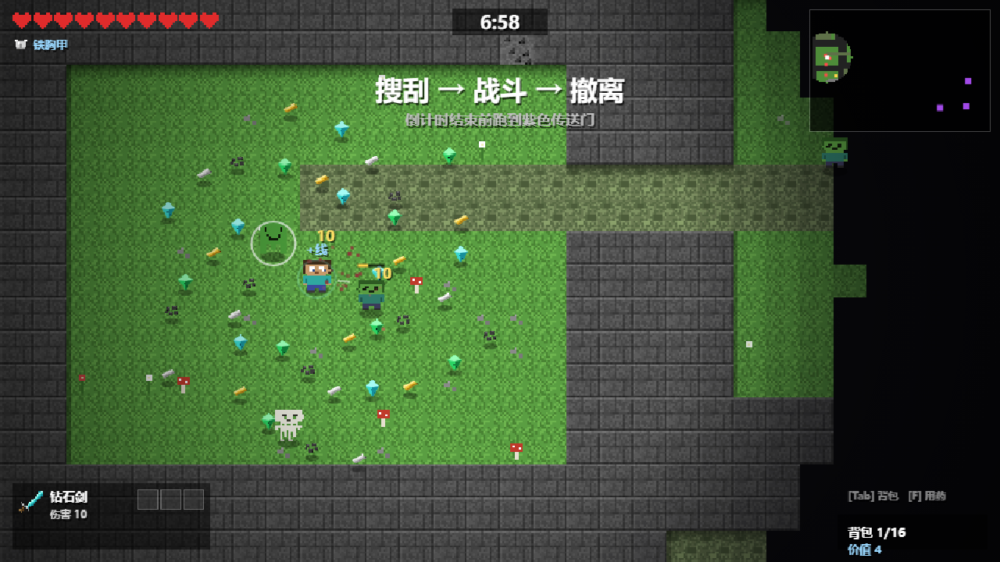

# 方块撤离 · BLOCK EXTRACTION

> Minecraft 风格的**俯视角搜打撤** H5 单机小游戏。带装备钻进方块地牢，搜箱挖矿、砍僵尸、掐着倒计时冲进传送门撤离；死了，身上的东西就都没了。

纯前端：**零依赖、零构建、零联网**，双击 `index.html` 就能玩，也可以直接挂 GitHub Pages。



---

## 玩法

**搜 → 打 → 撤**，一局 4~9 分钟。

1. 在**基地**整备：武器、护甲、背包、快捷道具，买点药。
2. 进图，**搜**木箱 / 熔炉 / 工作台，**挖**墙上的煤矿到远古残骸。
3. **打**僵尸、蜘蛛、骷髅、苦力怕、末影人、烈焰人，下界深处还有凋灵。
4. 倒计时结束前站进**紫色传送门**，连续 5 秒不挨打 → **撤离成功**，战利品入库。
5. 阵亡或超时 → 携带的装备 + 本局战利品**全部丢失**（仓库里的安全）。

| 地图 | 时长 | 危险 | 特产 |
|---|---|---|---|
| 橡木平原 · 废弃矿井 | 7:00 | ★ | 煤炭、铁、少量钻石 |
| 深板岩矿洞 | 8:00 | ★★ | 钻石、绿宝石、苦力怕多 |
| 下界要塞 · 熔岩回廊 | 9:00 | ★★★ | 远古残骸、下界合金剑、凋灵 |

## 操作

| 操作 | 键鼠 | 手机 |
|---|---|---|
| 移动 | `WASD` | 左半屏拖动 |
| 瞄准 | 鼠标 | 自动朝最近敌人 |
| 攻击 | 鼠标左键（按住连击） | 右下 `A` |
| 开箱 / 挖矿 | `E` 或 右键 | 右下 `E` |
| 冲刺（短暂无敌） | `空格` | 右下 `D` |
| 快捷道具 | `1` `2` `3` | — |
| 快速吃药 | `F` | — |
| 背包（可换武器/护甲/背包） | `Tab` | — |
| 暂停 | `Esc` | — |

> 钻石矿和远古残骸**必须带钻石镐**才能挖。带镐子就少一把好武器，这就是取舍。

## 内容

- **物品**：煤炭 / 铁锭 / 金锭 / 红石 / 青金石 / 下界石英 / 绿宝石 / 钻石 / 远古残骸 / 骨头 / 线 / 火药 / 腐肉 / 蜘蛛眼
- **武器**：木剑 → 铁剑 → 钻石剑 → 下界合金剑，弓、弩，铁镐 / 钻石镐
- **护甲**：皮革 / 铁 / 钻石胸甲（15% / 30% / 45% 减伤）
- **背包**：皮革背包 / 大背包 / 潜影箱（+6 / +10 / +16 格）
- **消耗品**：苹果、面包、金苹果、治疗 / 迅捷 / 力量药水、TNT、末影珍珠
- **局外成长**：仓库、商店、生命/背包/移速升级、3 条可重复委托
- **存档**：`localStorage` 自动保存，关掉浏览器不丢

## 素材说明

所有像素素材都是**代码里程序化绘制**的（`js/pixel.js`）：复刻 MC 原版的辨识度——钻石的切面、金锭的斜条、钻石剑的斜刃、苦力怕的脸、骷髅的骨白——但不打包任何 Mojang 原版贴图文件，避免版权问题，同时做到零加载。

想换成真实贴图：改 `js/pixel.js` 里 `P.item()` / `P.tile()` / `P.mob()` 三个入口，把 `16×16` PNG 贴进去即可，其它代码不用动。

## 目录

```
index.html          入口
css/style.css       界面样式（MC 风格 GUI）
js/pixel.js         程序化像素素材（图标 / 方块 / 怪物）
js/data.js          数值表（物品、敌人、掉落、地图、商店、任务）
js/engine.js        工具 / 输入 / 相机 / 粒子 / 程序合成音效 / 存档
js/world.js         随机地图生成（房间 + 走廊 + 分级）/ 碰撞 / 黑雾
js/entity.js        玩家 / 敌人 AI / 弹道 / 掉落 / 伤害 / 交互
js/render.js        渲染与小地图、HUD
js/ui.js            基地 / 仓库 / 商店 / 结算 / 局内背包
js/game.js          状态机与主循环
js/smoke.js         端到端冒烟测试（?smoke=1 时运行）
tools/              素材表与调试截图页
GAME_DESIGN.md      设计文档与待确认清单
```

## 本地运行

```bash
# 直接双击 index.html 也行；想跑本地服务器：
python -m http.server 8000
# 打开 http://127.0.0.1:8000
```

## 自测

```
http://127.0.0.1:8000/index.html?smoke=1
```
页面会把三张地图生成、开箱、撤离、死亡掉装、全怪物 AI、存档读写、界面渲染跑一遍，最后在 `#bootlog` 输出 `SMOKE-OK`。
